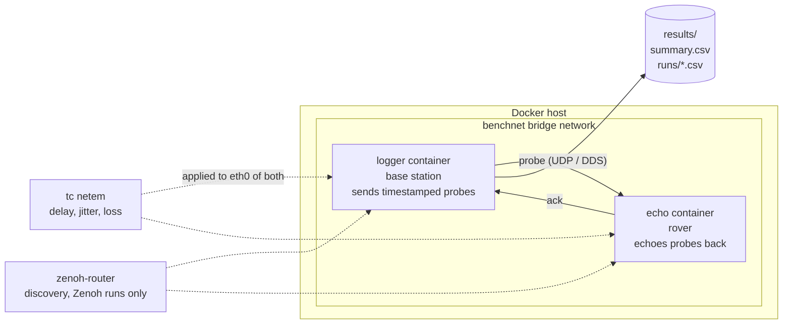

# ros2-net-bench

A containerized ROS 2 Jazzy link benchmark for a rover and its base station. It measures round-trip latency, jitter, packet loss and goodput, uses Linux `tc netem` to simulate the radio link getting worse as the rover drives away, and compares two ROS 2 middlewares: DDS (Fast DDS) and Zenoh.

I built the original benchmark nodes for the communications subteam of [TASC](https://github.com/Combat-Craft), TMU's rover team competing at the Canadian International Rover Challenge. This repo packages them so that anyone can reproduce a test run with one command, and so that every change is checked automatically in CI.


## How it works



1. The **logger** (base station) waits for DDS discovery to find the echo node, then publishes probes at a fixed rate. Each probe carries a sequence number and a monotonic timestamp.
2. The **echo** node (rover) sends every probe straight back.
3. The logger computes round-trip time for each echo. Probes that never come back count as lost.
4. Results go to `results/runs/<label>.csv` (one row per probe) and `results/summary.csv` (one row per run).

## Setup (Ubuntu 24.04, x86-64 or ARM)

1. Install Docker Engine and the Compose plugin ([docs](https://docs.docker.com/engine/install/ubuntu/)), then run `sudo usermod -aG docker $USER` and log out and back in.
2. Make sure the kernel's netem module is available. Containers share the host kernel, and some Ubuntu installs ship it in a separate package:

   ```bash
   sudo modprobe sch_netem || (sudo apt install -y linux-modules-extra-$(uname -r) && sudo modprobe sch_netem)
   ```

   If you skip this, any profile other than `none` fails with `Specified qdisc kind is unknown`.

## Quick start

```bash
git clone https://github.com/aayan-h102/ros2-net-bench.git
cd ros2-net-bench

docker compose build
docker compose up -d echo                                   # start the "rover"
docker compose run --rm logger --rate 20 --payload 100 --duration 15
docker compose down
```

Run on a degraded link:

```bash
export NETEM_PROFILE=far
docker compose up -d --force-recreate echo
docker compose run --rm logger --rate 20 --payload 100 --duration 15
```

Run over Zenoh instead of DDS:

```bash
export RMW_IMPLEMENTATION=rmw_zenoh_cpp
docker compose up -d --force-recreate echo
docker compose run --rm logger --rate 20 --payload 100 --duration 15
```

## Full test matrix

```bash
./scripts/run_matrix.sh                                     # 2 middlewares x 4 profiles x 2 rates x 2 payloads, ~20 min
pip install matplotlib                                      # optional, for plots
python3 net_bench/net_bench/analyze.py results/summary.csv  # writes results/report.md (+ plots)
```

| Variable | Default | Meaning |
| --- | --- | --- |
| `RMWS` | `rmw_fastrtps_cpp rmw_zenoh_cpp` | middlewares to test |
| `PROFILES` | `none near mid far` | link profiles to test |
| `RATES` | `10 25` | probe rates in Hz |
| `PAYLOADS` | `100 500` | payload sizes in bytes |
| `DURATION` | `30` | seconds per run |

### Link profiles

Applied with `tc netem` on both containers, so round-trip delay is about twice the one-way value.

| Profile | One-way delay | Loss |
| --- | --- | --- |
| `none` | none | none |
| `near` | 5 ms ± 1 ms | 0.5 % |
| `mid` | 20 ms ± 5 ms | 2 % |
| `far` | 60 ms ± 20 ms | 8 % |
| `custom` | from `NETEM_ARGS` | from `NETEM_ARGS` |

These profiles are synthetic stand-ins, not measured RF data. The next step is to replace them with values from field range tests.

## Results

_Run `./scripts/run_matrix.sh` and paste `results/report.md` here._

## Logger options

```
--rate HZ               probe rate (default 10)
--payload BYTES         payload size per probe (default 100)
--duration S            sending window (default 30)
--grace S               wait for late echoes after sending stops (default 2)
--discovery-timeout S   how long to wait for the echo node (default 20)
--label NAME            run name for output files
--max-loss PCT          exit non-zero if loss exceeds this (used by CI)
```

## CI

GitHub Actions runs on every push:

1. **Unit tests**: `pytest` on the metric and report code, which has no ROS dependency.
2. **Docker smoke test**: builds the image and runs three checks:
   - DDS on a clean link: packet loss must be 5 % or less.
   - DDS on the `mid` profile: median RTT must be above 20 ms. This proves netem is really shaping the traffic.
   - Zenoh on a clean link: packet loss must be 5 % or less.

Results are uploaded as a build artifact.

## Design notes

- **DDS is forced onto UDP** (`config/fastdds_udp.xml`). Fast DDS can use shared memory between processes on the same host. That would skip the container network interface, and netem would have no effect.
- **The logger waits for discovery before sending.** Otherwise the first probes are published before the echo node is matched, and the run shows false packet loss.
- **Zenoh needs a router for discovery.** Each node is pointed at the `zenoh-router` container with `ZENOH_CONFIG_OVERRIDE`. The router has no netem applied, so it doesn't distort results.
- **QoS is best effort**, so lost packets stay lost instead of being hidden by retransmission.
- **RTT uses a monotonic clock on one machine**, so it needs no clock sync between the two ends.
- **Goodput** is payload bytes echoed back per second of the sending window. An earlier version divided message size by RTT, which measures latency, not throughput.

## Limitations and next steps

- Both containers run on one host, so the link is emulated, not radio.
- Run on Kubernetes (k3s). Most cluster networks don't carry multicast, so DDS discovery needs a Fast DDS discovery server.
- Run the same matrix on the real rover hardware and use the field data to calibrate the profiles.

## Repo layout

```
Dockerfile, docker-compose.yml   container image and two-node setup
config/fastdds_udp.xml           UDP-only DDS profile
scripts/                         entrypoint, netem profiles, test matrix
net_bench/                       ROS 2 package (echo, logger, metrics, analyze)
tests/                           pytest unit tests
.github/workflows/ci.yml         CI pipeline
```
